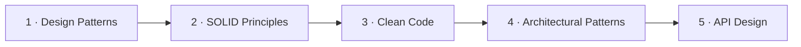

## 🏗️ Welcome to Absolute Bonkers!

*Welcome to Absolute Bonkers, your one-stop shop for all things System Design!  
🌟 Whether you’re a seasoned architect or just starting your journey into the world of designing robust systems, we’ve got you covered with a treasure trove of resources, examples, and insights.*

## 🚧 Work in Progress 🚧

*This project is currently under development.
For any queries or suggestions, please reach out to [Contributors](#contributors)*

### 📚 What We Offer

In this organization, you’ll find:

	•	Resources: Explore comprehensive guides and articles on various system design topics, from fundamentals to advanced concepts.
	•	Real-World Examples: Dive into practical examples that illustrate how to apply system design principles in real projects.
	•	Community Contributions: Join us in building a community of learners and experts. Feel free to contribute your own examples and resources!

### 💡 Why System Design Matters

*System design is crucial for building scalable, reliable, and maintainable applications. 
Whether you’re developing web apps, mobile apps, or distributed systems, understanding system design principles will help you make informed architectural decisions that impact your project’s success.*

### 🔗 Get Involved

*We encourage you to explore our repositories, contribute to discussions, and share your own insights. 
Together, we can create a vibrant community dedicated to mastering system design!*

### 🚀 Let’s Connect!

*Stay updated on our latest resources and contributions by following us on GitHub. 
If you have any questions or suggestions, feel free to reach out!*

--- 

### Contributors:
*Aditya Chandeliya -> https://github.com/imchandeliya*

___

### 🛒 Contents 

Each numbered module has one canonical repository; its individual topics are
organized as submodules or chapters inside that repository.

### Module 1: Design Patterns

- [GoF Design Patterns — introduction, all 23 patterns, examples, and tests](https://github.com/absolute-bonkers/design-patterns)
  - **Creational:** [Singleton](https://github.com/absolute-bonkers/design-patterns/blob/main/creational/dp-singleton/singleton.md) · [Factory Method](https://github.com/absolute-bonkers/design-patterns/blob/main/creational/dp-factory/factory.md) · [Abstract Factory](https://github.com/absolute-bonkers/design-patterns/blob/main/creational/dp-abstract-factory/abstract-factory.md) · [Builder](https://github.com/absolute-bonkers/design-patterns/blob/main/creational/dp-builder/builder.md) · [Prototype](https://github.com/absolute-bonkers/design-patterns/blob/main/creational/dp-prototype/prototype.md)
  - **Structural:** [Adapter](https://github.com/absolute-bonkers/design-patterns/tree/main/structural/adapter) · [Bridge](https://github.com/absolute-bonkers/design-patterns/tree/main/structural/bridge) · [Composite](https://github.com/absolute-bonkers/design-patterns/tree/main/structural/composite) · [Decorator](https://github.com/absolute-bonkers/design-patterns/tree/main/structural/decorator) · [Facade](https://github.com/absolute-bonkers/design-patterns/tree/main/structural/facade) · [Flyweight](https://github.com/absolute-bonkers/design-patterns/tree/main/structural/flyweight) · [Proxy](https://github.com/absolute-bonkers/design-patterns/tree/main/structural/proxy)
  - **Behavioral:** [Chain of Responsibility](https://github.com/absolute-bonkers/design-patterns/tree/main/behavioral/chain-of-responsibility) · [Command](https://github.com/absolute-bonkers/design-patterns/tree/main/behavioral/command) · [Interpreter](https://github.com/absolute-bonkers/design-patterns/tree/main/behavioral/interpreter) · [Iterator](https://github.com/absolute-bonkers/design-patterns/tree/main/behavioral/iterator) · [Mediator](https://github.com/absolute-bonkers/design-patterns/tree/main/behavioral/mediator) · [Memento](https://github.com/absolute-bonkers/design-patterns/tree/main/behavioral/memento) · [Observer](https://github.com/absolute-bonkers/design-patterns/tree/main/behavioral/observer) · [State](https://github.com/absolute-bonkers/design-patterns/tree/main/behavioral/state) · [Strategy](https://github.com/absolute-bonkers/design-patterns/tree/main/behavioral/strategy) · [Template Method](https://github.com/absolute-bonkers/design-patterns/tree/main/behavioral/template-method) · [Visitor](https://github.com/absolute-bonkers/design-patterns/tree/main/behavioral/visitor)

### Module 2: SOLID Principles

- [SOLID Principles — Java examples and tests](https://github.com/absolute-bonkers/solid-principles)
  - [Single Responsibility (SRP)](https://github.com/absolute-bonkers/solid-principles/tree/main/srp)
  - [Open/Closed (OCP)](https://github.com/absolute-bonkers/solid-principles/tree/main/ocp)
  - [Liskov Substitution (LSP)](https://github.com/absolute-bonkers/solid-principles/tree/main/lsp)
  - [Interface Segregation (ISP)](https://github.com/absolute-bonkers/solid-principles/tree/main/isp)
  - [Dependency Inversion (DIP)](https://github.com/absolute-bonkers/solid-principles/tree/main/dip)

### Module 3: Clean Code

- [Clean Code — Java examples and tests](https://github.com/absolute-bonkers/clean-code)
  - [Don't Repeat Yourself (DRY)](https://github.com/absolute-bonkers/clean-code/tree/main/dry)
  - [Keep It Simple (KISS)](https://github.com/absolute-bonkers/clean-code/tree/main/kiss)
  - [You Aren't Gonna Need It (YAGNI)](https://github.com/absolute-bonkers/clean-code/tree/main/yagni)
  - [Code Smells](https://github.com/absolute-bonkers/clean-code/tree/main/code-smells)
  - [Refactoring](https://github.com/absolute-bonkers/clean-code/tree/main/refactoring)

### Module 4: Architectural Patterns

- [Architectural Patterns — Java examples and tests](https://github.com/absolute-bonkers/architectural-patterns)
  - [Monolithic Architecture](https://github.com/absolute-bonkers/architectural-patterns/tree/main/monolithic)
  - [Microservices Architecture](https://github.com/absolute-bonkers/architectural-patterns/tree/main/microservices)
  - [Service-Oriented Architecture (SOA)](https://github.com/absolute-bonkers/architectural-patterns/tree/main/soa)
  - [Event-Driven Architecture (EDA)](https://github.com/absolute-bonkers/architectural-patterns/tree/main/event-driven)
  - [Hexagonal Architecture (Ports & Adapters)](https://github.com/absolute-bonkers/architectural-patterns/tree/main/hexagonal)
  - [Clean Architecture](https://github.com/absolute-bonkers/architectural-patterns/tree/main/clean-architecture)
  - [Layered (N-Tier) Architecture](https://github.com/absolute-bonkers/architectural-patterns/tree/main/layered)
  - [CQRS (Command Query Responsibility Segregation)](https://github.com/absolute-bonkers/architectural-patterns/tree/main/cqrs)
  - [Event Sourcing](https://github.com/absolute-bonkers/architectural-patterns/tree/main/event-sourcing)
  - [Serverless Architecture](https://github.com/absolute-bonkers/architectural-patterns/tree/main/serverless)
  - [Micro-Frontend Architecture](https://github.com/absolute-bonkers/architectural-patterns/tree/main/micro-frontends)

### Module 5: API Design & Communication

- [API Design & Communication — Java 21 examples and tests](https://github.com/absolute-bonkers/api-design-communication)
  - **API styles and protocols:** [REST API design](https://github.com/absolute-bonkers/api-design-communication/tree/main/api-styles/rest) · [GraphQL](https://github.com/absolute-bonkers/api-design-communication/tree/main/api-styles/graphql) · [gRPC & Protocol Buffers](https://github.com/absolute-bonkers/api-design-communication/tree/main/api-styles/grpc) · [WebSockets](https://github.com/absolute-bonkers/api-design-communication/tree/main/api-styles/websockets)
  - **API design and lifecycle:** [API versioning](https://github.com/absolute-bonkers/api-design-communication/tree/main/api-lifecycle/versioning) · [Idempotency](https://github.com/absolute-bonkers/api-design-communication/tree/main/api-lifecycle/idempotency) · [Pagination (cursor vs. offset)](https://github.com/absolute-bonkers/api-design-communication/tree/main/api-lifecycle/pagination) · [HATEOAS](https://github.com/absolute-bonkers/api-design-communication/tree/main/api-lifecycle/hateoas)
  - **Gateway and traffic control:** [API Gateway pattern](https://github.com/absolute-bonkers/api-design-communication/tree/main/gateway-traffic/api-gateway) · [Rate limiting and throttling](https://github.com/absolute-bonkers/api-design-communication/tree/main/gateway-traffic/rate-limiting)

### Module 6: Database Design & Storage

- Relational Databases (SQL) — Normalization, Indexing, Joins
- NoSQL Databases — Document, Key-Value, Column-Family, Graph
- Database Sharding (Horizontal Partitioning)
- Database Replication (Master-Slave, Master-Master)
- Database Indexing (B-Tree, Hash, Composite)
- CAP Theorem & PACELC
- ACID vs BASE
- Connection Pooling
- Data Warehousing & OLAP vs OLTP
- Time-Series Databases
- Database Migration Strategies

### Module 7: Caching

- Caching Strategies (Cache-Aside, Write-Through, Write-Behind, Read-Through)
- Cache Eviction Policies (LRU, LFU, TTL)
- Distributed Caching (Redis, Memcached)
- CDN (Content Delivery Network)
- Cache Invalidation
- Cache Stampede & Thundering Herd
- Application-Level vs Database-Level Caching

### Module 8: Messaging & Asynchronous Communication

- Message Queues (RabbitMQ, SQS)
- Event Streaming (Kafka, Google Pub/Sub)
- Pub/Sub Pattern
- Message Ordering & Exactly-Once Delivery
- Dead Letter Queues
- Saga Pattern (Orchestration vs Choreography)
- Outbox Pattern
- Backpressure Handling

### Module 9: Networking & Protocols

- OSI Model & TCP/IP
- HTTP/1.1 vs HTTP/2 vs HTTP/3
- DNS & How It Works
- Load Balancing (L4 vs L7, Algorithms)
- Reverse Proxy vs Forward Proxy
- SSL/TLS & HTTPS
- Long Polling vs Server-Sent Events vs WebSockets
- Connection Pooling & Keep-Alive

### Module 10: Scalability & Performance

- Horizontal vs Vertical Scaling
- Load Balancing Algorithms (Round Robin, Consistent Hashing, Least Connections)
- Consistent Hashing
- Database Read Replicas
- Auto-Scaling
- Capacity Planning & Estimation
- Back-of-the-Envelope Calculations
- Latency Numbers Every Programmer Should Know
- Connection Pooling
- Async Processing & Task Queues

### Module 11: Reliability & Fault Tolerance

- Availability vs Reliability vs Durability
- Redundancy & Replication
- Failover Strategies (Active-Passive, Active-Active)
- Circuit Breaker Pattern
- Retry with Exponential Backoff
- Bulkhead Pattern
- Health Checks & Heartbeats
- Graceful Degradation
- Chaos Engineering
- Disaster Recovery (RPO, RTO)

### Module 12: Distributed Systems

- Distributed Consensus (Raft, Paxos)
- Leader Election
- Distributed Locking
- Distributed Transactions (2PC, 3PC, Saga)
- Clock Synchronization (Lamport, Vector Clocks)
- Gossip Protocol
- Split-Brain Problem
- Quorum-Based Systems
- Bloom Filters
- Merkle Trees

### Module 13: Security

- Authentication (OAuth 2.0, JWT, SSO, SAML)
- Authorization (RBAC, ABAC)
- Encryption (At Rest, In Transit)
- Hashing & Salting (bcrypt, argon2)
- SQL Injection & XSS Prevention
- CORS
- API Security (API Keys, Rate Limiting, IP Whitelisting)
- Zero Trust Architecture
- Secrets Management

### Module 14: Observability & Monitoring

- Logging (Structured Logging, ELK Stack)
- Metrics (Prometheus, Grafana)
- Distributed Tracing (Jaeger, Zipkin, OpenTelemetry)
- Alerting Strategies
- SLOs, SLIs, SLAs
- Health Check Endpoints
- Application Performance Monitoring (APM)

### Module 15: DevOps & CI/CD

- CI/CD Pipelines
- Containerization (Docker)
- Container Orchestration (Kubernetes)
- Infrastructure as Code (Terraform)
- Blue-Green Deployment
- Canary Deployment
- Rolling Deployment
- Feature Flags
- GitOps

### Module 16: Real-World System Design Case Studies

- Design URL Shortener (TinyURL)
- Design Rate Limiter
- Design Notification System
- Design Chat System (WhatsApp/Slack)
- Design News Feed (Twitter/Instagram)
- Design Video Streaming (YouTube/Netflix)
- Design File Storage (Google Drive/Dropbox)
- Design Search Autocomplete
- Design E-Commerce (Amazon)
- Design Ride Sharing (Uber/Ola)
- Design Payment System
- Design Distributed Cache
- Design Ticket Booking (BookMyShow)
- Design Collaborative Editor (Google Docs)

### Module 17: System Design Interview Prep

- Framework for Approaching System Design
- Requirements Gathering (Functional & Non-Functional)
- High-Level Design → Deep Dive Flow
- Trade-offs & Justification
- Estimation & Napkin Math
- Common Mistakes to Avoid
